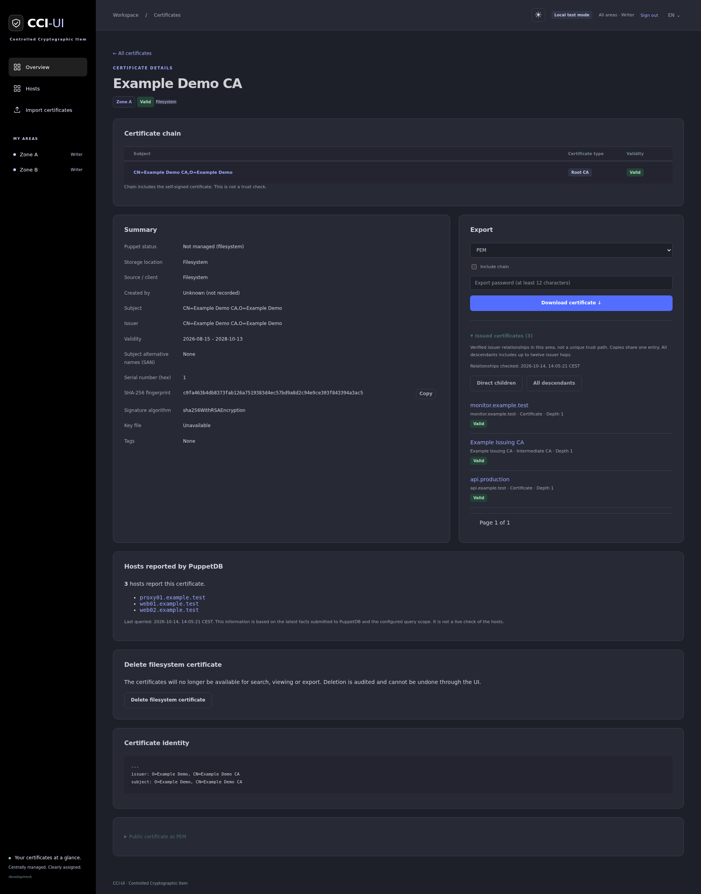

# CA inventory and Hiera export

CA inventory is always active as part of the regular index run. There is no
separate CA overview page. Open a root or intermediate certificate in the
certificate catalogue to inspect its chain and verified descendants.

After each successful full index pass, CCI-UI reads public certificate material
from all configured areas and both filesystem and Consul sources. Filesystem
entries marked missing by a complete scan are skipped, including while the
deletion safety limit blocks cleanup. All other non-deleted catalogued
versions participate, including inactive, archived and expired certificates.
Issuer discovery stays within each area, matching the certificate detail page
and existing access permissions. A CA needed in multiple areas must be present
in each area's inventory.

Candidates must have `basicConstraints: CA:TRUE`, permit certificate signing
when a key usage extension is present. Issuer names and signatures must match.
Chain completeness is independent of certificate validity dates and active version
selection. Expired and not-yet-valid certificates can complete a chain.
Validity badges in certificate details use the same states as the overview.
The Hiera export only includes currently valid CAs
that can be referenced. Consul exports require the active version because
`lookup` always resolves that selection. Self-signed roots and intermediate CAs are included
without an additional approval workflow. Chains are bounded to twelve issuer
hops, and cycles and missing usable issuers remain recorded in the area snapshot. This is
issuer discovery, not full TLS path validation or a revocation check.

Results are deduplicated by SHA-256 fingerprint within each area. Verified
signature matches are stored as fingerprint references in the PostgreSQL snapshot.
Root/intermediate recognition and cached diagnostics remain independent of the UI.

Certificate detail pages show a hierarchy for the resolved issuer
chain, ending with the selected certificate. The detail-page chain
omits fingerprints and truncates long subjects with an ellipsis. Hovering over a
subject reveals its full value. Validity stays visible without horizontal scrolling.
On narrow screens, the certificate-type column is hidden to leave room for
subject and validity. The highest available
issuer appears first. Missing roots keep the incomplete-chain notice, and
certificates without a catalog entry remain visible without a detail link.

## Hiera download

The existing authenticated `GET /ca_inventories/:area` YAML download remains
available, for example `/ca_inventories/zone_a`. It is restricted to the signed-in
identity's areas. The collection URL `/ca_inventories` has no route or UI.

The Hiera output
is a YAML list of source-specific references. Consul entries use `lookup` with
the unqualified CertID. Filesystem entries preserve the DN escaping and `.tag`
suffix from the certificate detail page:

```yaml
---
- issuer: CN=Example Root CA, O=Example
  subject: CN=Example Root CA, O=Example
- lookup: example-issuing-ca
```

`lookup` identifies Consul material, while `issuer` and `subject` identify
filesystem material. Each download belongs to the area in the URL, which
must be retained in the consuming Hiera context. Existing filesystem references
need no migration. Certificate details show identity YAML (`certid` and `area` for Consul,
`issuer` and `subject` for filesystem sources), not a generated Puppet class.
This does not change the integration or CA Hiera download format.

Identical references appear once in the YAML, even if multiple distinct
certificates share those references. The inventory retains their separate
fingerprints. A reference does not pin a version: a Consul lookup resolves the
selected active version, and filesystem resolution follows the existing Puppet
lookup. Scanning historical versions does not make their material independently
addressable by this format. Consumers must validate the material resolved by
their lookup before installing it in a trust store.

This feature does not create Java stores or install certificates in an operating
system. It produces references for the consuming Puppet code.

CAs that expire between scans are immediately excluded from YAML. Displayed
validity badges update at request time. The scan timestamp and chain diagnostics
still describe the last scan.
A source read failure retains the previous complete snapshot and marks it stale.
A successful later scan clears that warning. Private keys are never loaded.

## Issued certificates on CA details

A CA or intermediate detail page includes an initially collapsed **Issued
certificates** panel, including when no children have been found. It is visible to
readers without export permission and does not require configuration. The panel
distinguishes four states: verified descendants, no subordinate certificates,
no successful synchronization yet, and failed synchronization with a potentially
stale snapshot. A failed first scan also indicates that no successful scan exists;
a failed later scan keeps previously verified relationships and their timestamp.
CA recognition uses the loaded public certificate even before the first scan.
It shows direct children by default; **All descendants** traverses up to twelve
issuer hops. Results are deduplicated by DER fingerprint within the permitted
area and paginated at twenty certificates. Links include CertID/name, type and
current validity. Existing export permissions and formats are unchanged.

The panel reads `ca_inventories.issuer_edges`, populated during the existing
public-material scan. Edges require a matching X.509 issuer name, CA constraints,
certificate-signing key usage where present, and a verified signature. Cross-signed
parents remain separate certificates; children with multiple matching parents
are labeled ambiguous. The list is an inventory graph, not a unique trust path.
Missing issuers create no guessed edges. The snapshot timestamp and stale marker
remain visible; a failed scan retains previous data. Existing snapshots acquire
edges on their next scan. No stored CA data is migrated or removed.



## Public CAs and trust stores

Public CAs are included when present in the local inventory. No assumptions are
made about a target distribution, JDK vendor, version or customized trust store.
For a standalone Java trust store, the consumer must supply every required trust
anchor. When extending an existing store, compare certificate fingerprints with
the actual target store before adding duplicates. Name matching alone is not
sufficient to establish that the same certificate is already installed.

Adding an intermediate as a trusted certificate can make it a trust anchor in
its own right. Consumers can use the root/intermediate labels to decide which
certificates belong in their stores. CCI-UI does not automatically install either.

Missing issuers are reported without outbound AIA requests. A manually triggered
AIA download and preview is a possible follow-up feature.

Deleting a filesystem CA invalidates the area snapshot immediately. The next
scan rebuilds the hierarchy without deleted records and reports any resulting
issuer gaps. See [filesystem deletion](legacy-deletion.md).

## Reproducing the screenshot

The isolated screenshot stack seeds generated certificates and demo identities.
It has its own PostgreSQL and Consul services and does not mount real inventory
data. Start it with `docker compose -f script/screenshots/compose.yml up --build
-d --wait`. With Puppeteer and Chromium installed, run
`node script/screenshots/capture.cjs`.
Use `PUPPETEER_MODULE` and `PUPPETEER_EXECUTABLE_PATH` for non-default installations.
The script checks chain hierarchy, validity badges, navigation and the initially
collapsed CA descendants panel before completing. Rails integration tests verify
the four synchronization states and the unchanged Hiera download contract.
Remove the disposable services afterward with
`docker compose -f script/screenshots/compose.yml down --volumes`.
