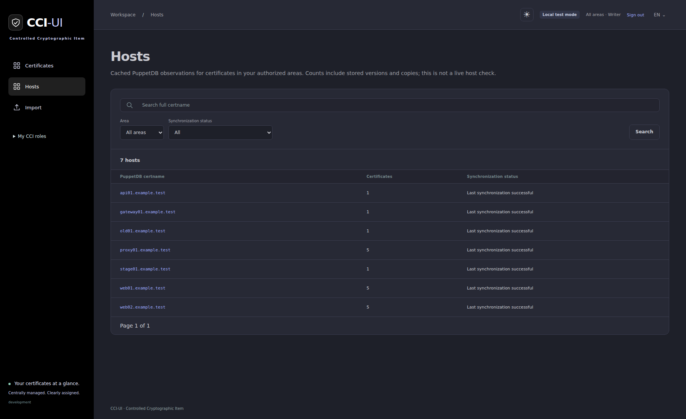
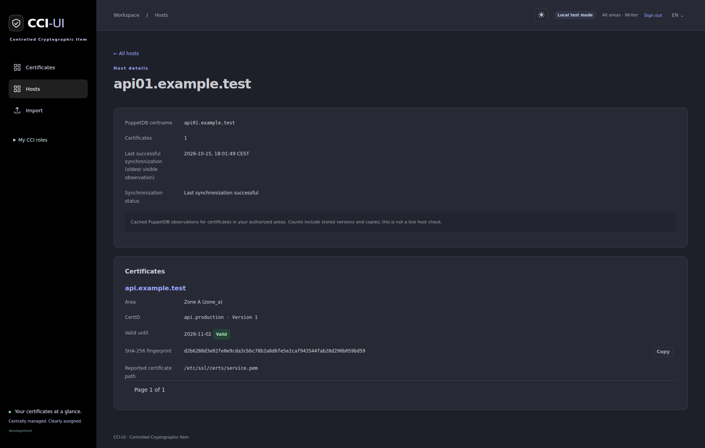

# PuppetDB host inventory

This optional feature associates catalog certificates with nodes that report
them in a custom fact. It is disabled by default and does not deploy or modify
any Puppet class, certificate, key, status or audit event. The names in this
document are anonymized examples, not dependencies on a particular organization
or custom Puppet module.

## Query and configuration

Set `puppetdb.enabled: true`, `puppetdb.url` and your actual
`puppetdb.inventory.fact_name`. With the example fact name `certificates`, the default query
is:

```text
inventory[certname,facts]{ certname in fact_contents[certname]{ name = "certificates" } }
```

Override it through `puppetdb.inventory.query` if needed. Results must contain `certname`
and `facts`, including the configured certificate fact in every row. The query
defines the host population being counted; use it to restrict environments or
other deployment scopes. Do not use `limit` or `offset`: synchronization needs
the complete population and rejects an inconsistent `X-Records` total when the
server supplies that header. This check cannot prove that a custom query covers
every intended host or detect a server that silently omits rows with a matching
or absent total.

CCI-UI sends the PQL string as JSON in a POST request to `/pdb/query/v4`.
Puppet documents [PQL queries over HTTP](https://help.puppet.com/pdb/8/topics/tutorial-pql.htm),
[TLS and token authentication](https://help.puppet.com/pdb/8/topics/curl.htm),
and the [total result count header](https://help.puppet.com/pdb/8/topics/paging.htm).
All YAML settings, TLS mount examples and defaults are in
[YAML configuration](configuration.md#parameter-reference).

## Fact format and certificate identity

Set `puppetdb.inventory.fingerprint_algorithm` to match the custom fact: `sha256`
(default, 64 hex characters) or `sha1` (40 hex characters), each over the
certificate's DER encoding. Use the exact lowercase YAML values `sha256` or `sha1`. The catalog identity, archive scope and Consul keys continue using
SHA-256. SHA-1 is an optional compatibility value for inventory matching only.
Text search by fingerprint continues to use SHA-256, even in SHA-1 host matching mode.
CN, subject, issuer, filename and Puppet certid are not reliable identifiers of
a particular certificate version. A fingerprint that does not match the
configured algorithm is rejected instead of silently clearing associations.

Both fingerprints are computed when certificate material is indexed. Existing
retained records acquire the additional SHA-1 digest on their next successful
source scan. If their source is no longer available, SHA-1 matching remains
unavailable: previous observations are preserved, and the UI shows “Fingerprint
fehlt” rather than claiming a newly confirmed zero hosts. SHA-256 matching can
still use their existing catalog identity.

An anonymized query result can look like this:

```json
[
  {
    "certname": "app01.example.test",
    "facts": {
      "certificates": [
        {
          "path": "/etc/ssl/certs/service.pem",
          "fingerprint": "0123456789abcdef0123456789abcdef0123456789abcdef0123456789abcdef"
        }
      ]
    }
  }
]
```

The fingerprint above is illustrative. Upper/lowercase hexadecimal and
colon-separated bytes are accepted, as are `SHA256 Fingerprint=` and `SHA256:`
prefixes for SHA-256, or `SHA1 Fingerprint=` and `SHA1:` for SHA-1. The entry field name defaults to `fingerprint` and can be changed with
`puppetdb.inventory.fingerprint_field`, for example to `sha256`.

The selected fact may be a single fingerprint string, a list of fingerprint
strings or certificate objects, or a map keyed by file/name whose values have
one of these forms. For example, the following is also supported:

```json
{
  "/etc/ssl/certs/service.pem": {
    "fingerprint": "0123456789abcdef0123456789abcdef0123456789abcdef0123456789abcdef"
  }
}
```

An optional absolute `path` or `file` property is retained; an absolute map key
can supply the path too. Control characters and paths longer than 4096 characters
are ignored. Other properties on a fingerprint object are ignored.
Other facts are ignored entirely and are not stored. An empty list or map means
the host reports no certificates. Null, a missing fact, an invalid fingerprint,
or an unsupported shape rejects the complete response. Adapt the custom fact
to one of the documented formats rather than relying on guessed identities.

Every host is counted once per fingerprint, regardless of duplicate files or
rows. Matching catalog records across sources, areas and historical versions
share the same host list. Certificate access permissions still apply, but
there is no separate host authorization model: anyone allowed to view a
certificate can see all its matching hosts within the configured query scope.

## Host list and details

With the integration enabled, **Hosts** opens `/hosts`: search full certnames,
filter by permitted area and synchronization state, and browse thirty hosts per
page. Selecting a host opens its details with the full PuppetDB certname,
certificate count, oldest successful observation among visible associations,
synchronization status and paginated certificate records. Each record shows its
area, actual CertID/version or filesystem identity, validity, full SHA-256
fingerprint with copy button, detail link and any reported file paths.

Host pages are a permission-scoped SQL projection of `certificates.puppetdb_hosts`;
there is no separate Host model or second synchronization job. Counts refer to
visible catalog records, including versions and source/area copies. One certificate
can belong to several hosts. Hosts with no visible associated certificate are
absent, so a user cannot discover hosts solely through another area's records.
Encoded route IDs preserve the entire certname and are not authorization tokens.
Pages perform no PuppetDB requests. Disabling the integration hides navigation
and makes both host endpoints return 404.

Historical versions and archives are labeled. Failed refreshes, missing selected
digests and unqueried associations are not shown as current. A successful empty
response clears associations and paths, causing now-unassociated hosts to disappear.
An indexer that stops without attempting a query cannot create a failure marker;
check the displayed observation time. These are PuppetDB observations, not live
certificate deployment or service checks.

The additive migration stores only optional reported public paths in
`certificates.puppetdb_paths` (host-to-path arrays), alongside the existing host
cache. Existing rows start empty and acquire paths on the next successful scan;
no certificate material or external Puppet schema is migrated.





## Refresh and display behavior

The scheduled indexer refreshes hosts once per indexing pass, after certificate
indexing. The default `indexer.interval_seconds` is 60 seconds between completed passes.
Interactive status changes, imports, searches and detail requests never query
PuppetDB; they use cached database results. Archived entries also retain their
host list, which can help track a pending Puppet deletion request.

- “Hosts” shows a distinct host count in the overview and links to the detail
  section “Hosts laut PuppetDB”.
- “–” means there has not yet been a successful query for that catalog record.
- `0` means the complete successful response reported no matching host within
  the configured query scope.
- Details list host certnames and the time of the last successful query.
- A failed query preserves the previous host list and timestamp and displays
  a warning. The next successful query clears the warning.

The host section also appears for filesystem certificates, whose Puppet status
and archive controls remain unavailable. Filesystem deletion is a separate
[writer action](legacy-deletion.md). Host reporting does not grant Puppet control
over those entries and does not copy their certificate material to Consul.

The warning reflects a recorded failed query, not a background liveness check.
If the indexer stops entirely, its last successful timestamp remains visible
without a new error marker. Monitor the indexer process and observation time.
After changing the query, fact or fingerprint settings, existing cached results
remain until a successful refresh under the new configuration. Entries missing
the newly selected digest continue to show their earlier observation and warning.

All result parsing completes before a database transaction replaces cached host
lists. A successful empty response clears only host associations, never
certificate catalog entries. HTTP errors, timeouts, TLS failures, oversized
responses, malformed facts and detectable truncation leave associations intact.
Messages do not include credentials, query text or raw facts. Full results are
fetched in one request to avoid inconsistent offset pages; increase
`puppetdb.request.max_response_bytes` if the complete inventory exceeds its 50 MiB default.
The client connects directly to the configured URL, without environment HTTP
proxies, redirects or automatic request retries. A later scheduled pass retries
after a failure. Use the final reachable endpoint, including any reverse-proxy
base path; do not append `/pdb/query/v4` yourself.

These facts describe the latest inventory known to PuppetDB, not a live probe
or proof that a service currently uses the certificate. A successful fetch does
not make old node facts fresh, and the displayed timestamp is the query time,
not the time each node inspected its files. Deactivated nodes and custom query
filters may exclude hosts. When `puppetdb.enabled: false`, requests and UI elements
are disabled while cached data remains available for a later re-enable.
