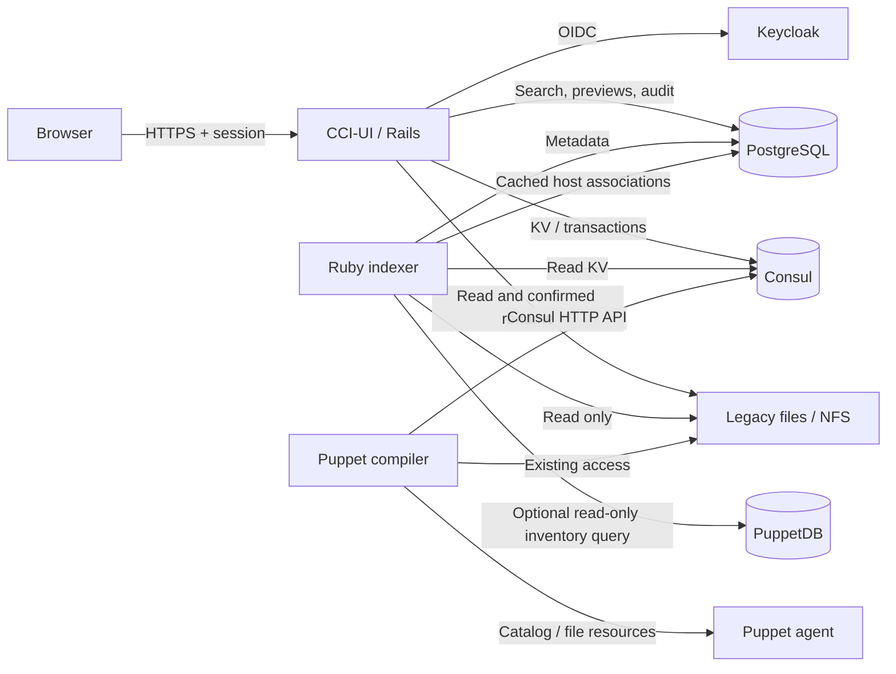
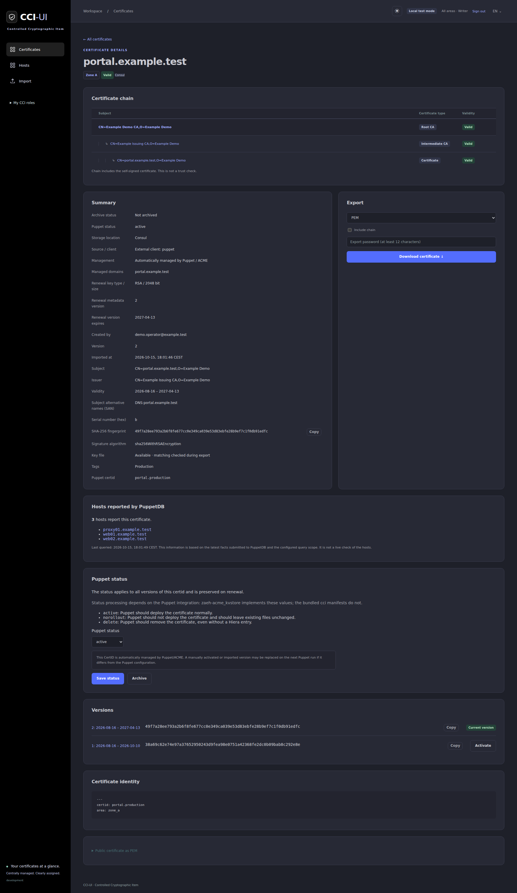
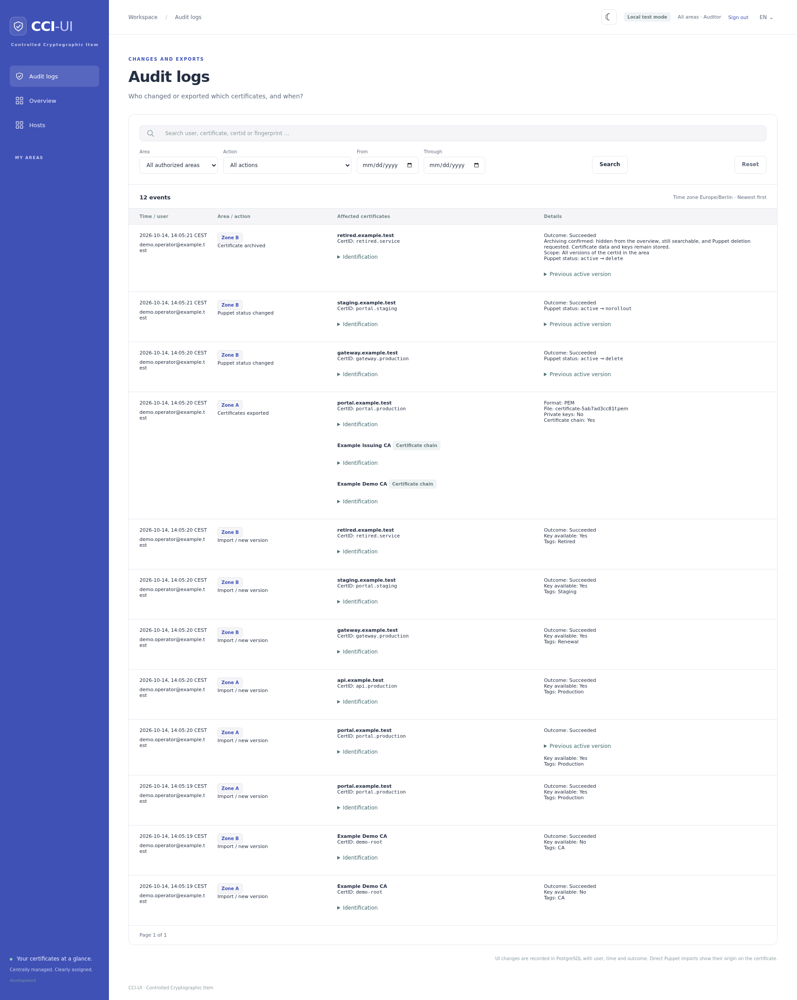

# CCI-UI: technical architecture

This architecture overview includes filesystem reconciliation as of 9 October 2026. It covers
configurable areas, import confirmation, Consul-only status and archiving,
reconciled filesystem inventory, audit logging and optional PuppetDB host
associations.
Consul is the authoritative store for imported certificates.

## Components and data flow



Rails serves user requests, enforces permissions, processes X.509 certificates
and container formats, and writes Consul transactions. The indexer runs as a
separate Ruby process using the same container image. PostgreSQL provides the
shared search index and relational management database. Consul is the source of
truth for new certificates and keys. The file system remains the source of truth
for legacy material; no material migration takes place. Only Consul certificates
have mutable Puppet status and archive metadata. Filesystem deletion renames files and retains PostgreSQL `deleted_at` tombstones.
See [filesystem deletion and failure handling](legacy-deletion.md).

Puppet uses the Consul HTTP API directly. Rails, Keycloak and PostgreSQL are not
in the runtime path of a Puppet compile. Consul must remain available for these
requests. Existing NFS access is unchanged.

## Certificate details

The detail view shows a chain hierarchy from root CA through intermediates to
the selected certificate, with validity badges and links. Metadata, reported
PuppetDB hosts, status and archive controls, versions and source-specific identity
appear below it. This dark-theme example uses synthetic certificates and hosts.

The optional `acme_renewal` extension is read directly from the CertID metadata
in Consul. Valid summaries show automatic Puppet/ACME management, domains, key
parameters and the version/expiry described by the external writer. Manual
import and activation show a neutral management notice, grouped with the status
controls on details, and retain the existing permissions and
confirmation workflow. Unknown metadata remains intact during all UI writes;
it is not a new catalog classification or storage source.

Fingerprints in certificate details, version rows and host details are complete,
monospace and wrap on narrow screens. Copy buttons copy the exact complete value;
if browser clipboard permission is unavailable, select the value manually.
Consul identity YAML contains only the actual `certid` and `area`, including for
old versions and archives. Filesystem identity keeps `issuer` and `subject`
(including the existing `.tag` convention), with no invented CertID. Puppet/Hiera
integration exports retain their existing format.

CA details always include a collapsed, paginated view of verified direct or
transitive children, with distinct empty, pending and failed-synchronization states; see [CA inventory](ca-inventory.md#issued-certificates-on-ca-details).



## PostgreSQL

| Table | Contents and responsibility |
| --- | --- |
| `certificates` | Area, source, source reference, originating `client`, `created_by` actor, certid, SHA-256 identity, optional SHA-1 digest, subject, issuer, SANs, tags, validity, key availability, active version, `rollout_status`, `archived`, cached PuppetDB hosts/query timestamps and search text |
| `certificate_requests` | CSR identity, public request fields, encrypted private key and revoke password |
| `csr_certificates` | Issued certificate history, issuer material, verification state and durable publication intent |
| `audit_events` | Actor, action, area, event time in `occurred_at`, references and persistent certificate metadata/export options in `details` and mutation outcome |
| `import_drafts` | Session owner, random preview token, expiry after 15 minutes, parsed import data with private keys already encrypted, destination certid indexes and previous version IDs |

Certificate metadata contains neither private keys nor import passwords. Import
previews contain public certificates and separately encrypted keys. A preview
is consumed once under a database lock; the indexer removes expired previews.
Each preview is bound to its login session. The selected area and its write permission
are checked again before saving. Before preview and commit, a fresh disk scan
rejects any upload containing certificate DER already in any configured legacy inventory,
independent of certid and destination area. The whole batch is rejected before
writes; stale search metadata is not used to decide duplication. An incomplete
or unavailable inventory blocks the upload. Existing destination certids require explicit
overwrite confirmation. A changed certid index, including a new certid created
after preview, rejects that entry and requires a fresh preview.

Filesystem projections additionally store `filesystem_source_path` (the resolved
inventory root), `filesystem_missing_scans` and `filesystem_cleanup_blocked`.
The latter persists a safety-limit block until rediscovery or explicit approval.
Existing rows start with an unknown root and zero confirmations; only a subsequent complete scan that finds
them assigns the root. Unobserved rows remain protected from automatic deletion.

`pg_trgm` indexes search text. Multiple search terms are combined with AND.
Subject, issuer, CN, SANs, tags and Puppet certid are searchable; fingerprints
and hexadecimal serial numbers also support normalized exact matching. SQL
handles filtering and sorting, with 30 results per page. Weighted relevance
ranking and typo correction are not currently implemented.

## Consul data contract

Default prefix: `cci`. `<area>` is a stable ID from `areas`.

| KV path below the prefix | Value |
| --- | --- |
| `<area>/certids/<certid>` | Integer `active_version` and `latest_version`, status, last writer/time and optional archive fields |
| `<area>/certs/<certid>/<version>` | One PEM certificate, tag array, Boolean key availability and import provenance |
| `<area>/keys/<certid>/<version>` | AES-256-GCM envelope |

Versions are positive integers per area/CertID pair. A renewal allocates
`latest_version + 1`, even after activation of an older version. Leaf and explicit CertID
imports create a version, including repeated material. Automatically named CA
imports reuse an identical existing issuer; new issuers use the shared
CN/organization and expiry-date convention, with a fingerprint collision suffix. Fingerprints
and X.509 metadata are derived from the PEM. No chain is stored. Clients assemble
chains from independently stored certificates when needed.

A writer reads metadata once and publishes the metadata, certificate and optional
key in one atomic Consul transaction. Metadata uses CAS against its `ModifyIndex`.
New material uses `cas` with `Index: 0`. A reader uses one metadata request followed
by one material request, optionally combining certificate and key in a read
transaction. Chain discovery requires additional reads. A bulk import consists
of separate certificate transactions and can partially succeed.

UI writes carry `client: "cci-ui"` and the authenticated actor. Direct Puppet
imports carry `client: "puppet"` and the import timestamp. There are no Consul
audit events. See the [complete contract and Ruby examples](consul-schema.md).

Only Consul certificates have mutable status and archive state. Status applies
to all versions of a CertID and survives renewals. The supplied Puppet manifests
expose `active`, `norollout`, and `delete` but do not enforce these statuses.
The optional external `zaeh-acme_kvstore` integration does enforce them;
[deployment and ACME renewal are separate](puppet.md#deployment-and-renewal-are-separate).
Archiving sets `archived: true` and `status: delete` while retaining material.

## Area configuration

`CciConfiguration` safely loads and validates one immutable YAML snapshot at
startup. Existing area, key, expiry, OIDC, reconciliation and integration
resolvers read this snapshot. `areas` contains display names, encryption keys,
optional filesystem paths and Consul overrides. Global Consul settings are
merged per area, consistently across all consumers. No ENV fallbacks remain.
See [YAML configuration](configuration.md) for types, defaults and secrets.

New imports and CSR creation/publication select exactly one area. Identical
certificate DER may exist independently in different areas. Existing historical
multi-area CSR records remain stored and accessible under their original
all-target permissions, but cannot be published again.

Roles are generated from each ID and the suffixes `reader`, `writer`,
`key_exporter`, `auditor` and independent `csr`. UI labels and local test identities use the
configured display names. Unknown roles grant no access. Existing IDs must not
be renamed or reused: they form part of Consul paths, audit records, roles and
the authenticated encryption context. Display names can be changed independently.
Removed areas become inaccessible; their stored certificates and audit records
are retained.

## Encryption and permissions

Private keys are encrypted with AES-256-GCM. Each area requires its own
Base64-encoded, 32-byte secret in `areas.<id>.encryption_key`. The authenticated
additional data is `cci:<area>:<certid>/<version>`, preventing successful decryption
when areas or versions are swapped. Key material and source passwords are
filtered from request logs. Exports use `Cache-Control: no-store`; private PEM
exports are password-protected.

| Role within an area | Search / details | Import / versions / status / archive | Certificate export | Private-key export |
| --- | --- | --- | --- | --- |
| Reader | Yes | No | No | No |
| Writer | Yes | Yes | Yes | No |
| Key Exporter | Yes | No | Yes | Yes |
| CSR | CSR workflow only | Matching CSR certificate publication only | CSR download only | No |
| Auditor | Audit logs only | No | No | No |

Version activation, status editing and archiving apply only to Consul
certificates. Auditor is an independent role for reading audit logs, without
certificate access or export permissions.

Roles follow the patterns `<area_id>_writer` and `<area_id>_key_exporter`.
Key Exporter is the sole authority for private-key export and is intentionally
separate from Writer. Additional roles grant permissions only within their area. Bulk exports check
every selected record, including selections spanning multiple areas. Any
unauthorized record causes the entire export to fail.

Keycloak is connected through OIDC Authorization Code with PKCE. The library
validates the ID token. Roles are read from `groups`, `realm_access.roles` and
client roles, and can be translated through `authentication.oidc.role_map`. These claims must
be available to the Keycloak client. The OIDC subject remains the stable user
UID for audit and write attribution. `authentication.oidc.display_name_claim` selects the
standard claim shown in the UI without changing that identity. Sessions last
one hour; role and display-name changes take effect when a new session is
established. Immediate role revocation and Keycloak backchannel logout are not
yet implemented. Local mode uses test identities generated from configuration
and is prohibited in production.

The optional `GET /integrations/zabbix` endpoint uses a stateless API controller
and its own YAML-configured bearer token, independently of Keycloak.
It reads an allowlist of public catalogue fields across configured areas and
never loads private material or creates a session. Renewal mode is derived from
writer provenance, preserving user identities. Monitoring defaults to Consul only,
with configurable filesystem or combined scope and fingerprint deduplication. See [Integrations → Zabbix](integrations/zabbix.md)
for inventory selection, authentication and monitoring policy.

Consul machine credentials are separate ACL tokens, independent of UI Reader
roles. Compilers need read access to their area's CertID metadata and certificates, plus
its private-key path and decryption secret when distributing keys. Tokens are
sent in headers, not URLs.

## Audit logs



`<area_id>_auditor` grants read access only to that area's audit logs at
`/audit_events`. Multiple Auditor roles allow a combined view of the corresponding
areas. These roles are independent of Reader, Writer and Key Exporter;
those roles do not automatically grant audit access. Authorization occurs before
querying and restricts search, filters, counts and pagination to permitted areas.

UI imports, activation, archiving and status changes persist an audit intent in
PostgreSQL before contacting Consul. The record includes the authenticated actor,
original timestamp, certificate identity, CertID, versions and before/after
metadata. It becomes `succeeded` after acknowledgment, `rejected` after a CAS
conflict, or `unknown` after a connection error. Process interruption can leave
`pending`. These outcomes are visible in the UI. Failure to store the intent
prevents the Consul write. A subsequent database failure cannot undo Consul and
can leave the durable intent unresolved. Automatic reconciliation is not implemented.

Direct Puppet imports do not create UI audit events. Their version metadata
identifies the client as `puppet` with a timestamp. UI history cannot be rebuilt
from Consul and requires PostgreSQL backups.

All successful CCI-UI exports (legacy files and Consul; PEM, DER, PFX, JKS, ZIP
and chains) are recorded in PostgreSQL after generation and before HTTP delivery.
Records contain the user ID (Keycloak's stable `sub`), time, area, format,
filename, key/chain options, and metadata for all selected certificates and
chain certificates actually included. Cross-area exports create one event per
area in a single database transaction. If audit persistence fails, no download
is delivered. An event confirms availability for delivery, not complete receipt
or storage on the user's device.

The UI shows Europe/Berlin time, including seconds and time zone. It provides
text search, area/action filters, inclusive date ranges and 30 events per page.
It offers no way to modify or delete events. Passwords, private keys and PEM
contents are excluded. Older entries without metadata remain visible as
historical references; timestamps of previously ingested legacy entries reflect
their original recording time. There is no automatic retention limit. Back up
PostgreSQL for all UI audit events.

The scope covers certificate changes and exports through CCI-UI. Temporary
import previews, index updates, failures before an audit intent, and direct Puppet/NFS/Consul
access outside the application are not included. The log is not a tamper-proof
archive against database or Consul administrators.

## Indexing and consistency

A PostgreSQL advisory lock serializes scheduled indexing, direct filesystem
refreshes and refreshes after upload, activation or status changes. It covers
the whole filesystem scan and cleanup, including administrator approvals.
The indexer reads legacy files and public Consul versions. Each filesystem
source has a separate scan, projection and reconciliation phase; database
updates for that source commit in one transaction. Two complete successful
scans must confirm absence before a bound filesystem row can be deleted.
Rediscovery resets its missing counter. Failed scans neither advance nor reset
confirmations. More than 20% deletion candidates relative to the pre-scan
bound, retained database population block all deletion for that source.
Repeated blocked scans retain the population and cannot drain it in batches.
Consul projections and status metadata are preserved when source entries disappear.
ACL-filtered Consul responses are treated as errors. All public versions are
scanned periodically; Consul blocking queries are not yet implemented.

If a Consul write succeeds but indexing fails, source data remains intact and
the next successful scan repairs the index. There is no distributed transaction
between Consul and PostgreSQL. The index is never used as the material source
for certificate or key exports. Source reference, area and fingerprint are
checked again when loading.

Legacy files are accessed through the root configured for their area. The web
service needs write access for confirmed deletion, while the indexer stays read-only. Symlinks outside
that directory are rejected. Multiple certificates in one PEM file receive
separate search records using the file path and block index. A certificate may
therefore appear more than once. `areas.<id>.filesystem.legacy_path` determines directory-to-area
assignment. The catalog key includes area, source, relative file/block ID and
fingerprint, so replacing a file creates a new identity and marks the previous
bound entry missing for guarded reconciliation. Matching filenames in different
roots are distinct records. Material reads,
private-key exports and Hiera tag reads explicitly select the record's area.
Removing a mapping blocks material reads and retains catalog rows. Missing or unreadable roots and malformed certificates report
indexing failures, while other areas and Consul indexing continue. Filesystem
indexing creates no Consul records.

Deletion preserves audit history and independent CSR records, removes cached
PuppetDB observations with the certificate row, and invalidates the area's CA
snapshot in the same transaction. CA discovery skips filesystem entries already
marked missing, avoiding repeated material-read failures during the grace period
or a blocked cleanup. Monitoring retains those entries until deletion, then
omits them on the next response. See
[filesystem reconciliation, limitations and administrator approval](legacy-deletion.md#automatic-filesystem-reconciliation).

Archiving persists `archived: true` together with Puppet `status: delete` in one Consul CAS transaction. The UI audit record is stored in PostgreSQL. Confirmation includes the scope:
all versions of a Consul certid in an area. Only Consul entries can be archived.
The PostgreSQL archive flag is projected from Consul and survives reindexing.
The overview and counts exclude archived entries; text searches and the
“Archivierte einschließen” option include them, even old versions. Material
availability does not prevent viewing retained filesystem details. There is no UI action to reverse archiving. Renewals preserve a
certid's archive state. See the [schema lifecycle rules](consul-schema.md#status-and-archiving).

## Optional PuppetDB host enrichment

When enabled, each scheduled indexing pass runs a PuppetDB inventory query after
the filesystem and Consul stages, including when either earlier stage reported
an expected source error. A PuppetDB failure does not undo certificate indexing.
Interactive Consul refreshes after UI mutations do not contact PuppetDB.

The client posts PQL as JSON to `/pdb/query/v4`, verifies TLS and optionally uses
a client certificate and/or token. It requests the full result once, checks
`X-Records` when supplied and bounds the response size. Only the configured
certificate fact is interpreted. Malformed rows, fingerprints or missing facts
reject the entire synchronization before associations change.

`certificates.puppetdb_hosts` contains sorted, unique certnames;
`puppetdb_paths` stores optional reported public paths per host;
`puppetdb_checked_at` records the last successful complete observation and
`puppetdb_error_at` records a failed attempt. Updates are atomic across catalog
records. The mapping uses the configured SHA-256 or SHA-1 fingerprints across
areas, sources and versions, including archives. SHA-256 remains the catalog
identity; the indexer additionally computes `sha1_fingerprint` from DER. Records
without that additional digest retain their previous observations in SHA-1 mode
until their source can be reindexed. It changes no certificate metadata, archive flags,
rollout status, Consul data or audit events. See [PuppetDB integration](puppetdb.md).

The host list and detail pages project these permission-scoped cached records
without network queries or an independent Host model. The additive migration
`20261014000100` adds only `puppetdb_paths` and the CA graph cache `issuer_edges`,
both empty JSON objects initially. Run `db:prepare` before starting new web and
indexer processes; their next scan populates the caches. No Consul content changes.

## Operations and limitations

Certificate metadata can be rebuilt after PostgreSQL loss only while its source
material still exists. Retained catalog entries for absent sources, UI audit
history and pending import previews require a PostgreSQL backup. Consul backups must include
certids, public certificate versions and encrypted keys.
Consul snapshots and area secrets are both needed to recover new private keys. Do not bake secrets into images.
Rotation with multiple simultaneously active encryption keys is not implemented;
existing secrets must not simply be replaced.

Chains are assembled using issuer/subject matching and signature verification.
This does not validate trust stores, OCSP or CRLs. JKS reads versions 1 and 2
and writes version 2; store and key passwords must match. PKCS#12 supports
multiple keys and certificates, AES/PBES2 and 3DES. RC2 and unknown bag types
produce an error rather than being silently ignored.

Tests use synthetic data. The production Keycloak realm, Consul ACLs and existing
Puppet NFS lookup have not been tested against your infrastructure because its
configuration has not been supplied.

## CSR requests and issued certificates

The independent `<area>_csr` role controls all `/certificate_requests` routes,
including request creation, lists, confirmed password disclosure and publication.
CSR-only users have no general catalog read/write or private-key export rights.

`certificate_requests` retains PKCS#10 requests, public subject fields and
AES-256-GCM encrypted private keys and revoke passwords. `csr_certificates`
retains issued-certificate history, verification status and durable CAS intents.
Neither table can be reconstructed by indexing Consul. Both belong in database
backups. The existing external area keys protect secrets with separate
area/request/purpose authenticated contexts.

CSR endpoints skip the global dependency gate so an existing authenticated
session can retain requests during Consul outages. Publication still requires
signature verification and a successful Consul transaction. Only the newest
submission can publish. Exact persisted transaction bytes reconcile lost replies
without creating another version. CSR audit events use the existing area-scoped
audit store. See [CSR validation, API, retry and rotation contracts](csr.md).

## Browser checks for inventory views

Use the disposable stack from `script/screenshots/compose.yml`, then run:

```console
node --test test/browser/inventory_test.cjs test/browser/localization_test.cjs test/browser/csr_test.cjs
node script/screenshots/capture.cjs
CSR_SCREENSHOT=1 node --test test/browser/csr_test.cjs
```

Install Puppeteer and Chromium for your supported Node version;
`PUPPETEER_MODULE` and `PUPPETEER_EXECUTABLE_PATH` select existing installations.
The inventory test checks full clipboard content, wrapping at 320–1440 pixels,
neutral management information and host navigation. The capture script refreshes
certificate/CA details, overview, host list/details and audit screenshots using
only synthetic data. Remove the disposable stack with
`docker compose -f script/screenshots/compose.yml down --volumes`.
